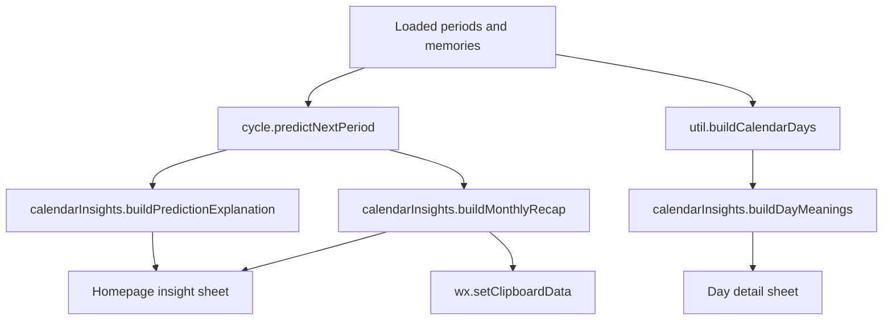

# Phase 2.1: Calendar Insight and Monthly Recap - Research

**Researched:** 2026-06-26
**Domain:** Period tracker calendar explanation, prediction transparency, and monthly recap UX
**Confidence:** HIGH

<user_constraints>
## User Constraints (from CONTEXT.md)

### Locked Decisions
- Add homepage-level explanations for marker meanings and prediction math.
- Build only a monthly recap for the sharing/couple enhancement direction.
- Keep implementation inside the existing mini program; no new backend, no medical advice, no paid or social features.
- Preserve explicit marker semantics: today, period, memory, prediction, holiday, and adjusted workday stay visually and textually distinct.

### the agent's Discretion
- Exact UI composition within the Aurora Bloom visual language.
- Exact helper module shape, as long as behavior is covered by tests.

### Deferred Ideas (OUT OF SCOPE)
- PDF/export report.
- Partner social feed, comments, or reactions.
- Screenshot test harness.
</user_constraints>

<architectural_responsibility_map>
## Architectural Responsibility Map

| Capability | Primary Tier | Secondary Tier | Rationale |
|------------|--------------|----------------|-----------|
| Calendar legend | Mini Program frontend | Utility helpers | Pure copy/data; no cloud dependency. |
| Prediction explanation | Utility helpers | Homepage frontend | Translates existing prediction object into user-facing explanation. |
| Day marker meanings | Utility helpers | Homepage detail sheet | Existing calendar day flags are already computed in `utils/util.js`. |
| Monthly recap | Utility helpers | Homepage frontend | Summarizes already-loaded period/memory data and copies text locally. |
</architectural_responsibility_map>

<research_summary>
## Summary

High-rated cycle apps converge on three useful patterns for this project: explain the calendar clearly, make predictions transparent without overstating certainty, and provide lightweight history summaries/export. Flo and Clue emphasize personalized insights and broad tracking, Stardust differentiates with daily/cycle recap style, Apple Health supports cycle history review/export, and simpler trackers remain highly rated because the calendar is understandable without much setup.

For Minmin Calendar, the best near-term move is not adding more medical or social complexity. The high-leverage version is a small "calendar understands itself" layer: legend, prediction explanation, date-level marker reasons, and a copyable monthly recap.

**Primary recommendation:** Add a pure `calendarInsights` helper plus homepage insight sheets; keep copy concise, confidence-qualified, and test-covered.
</research_summary>

<standard_stack>
## Standard Stack

No new frontend npm dependencies are recommended. WeChat Mini Program pages already use JavaScript, WXML, and WXSS without bundled frontend dependencies.

### Core
| Library | Version | Purpose | Why Standard |
|---------|---------|---------|--------------|
| Existing WeChat Mini Program runtime | Project configured | UI rendering and clipboard API | Required platform. |
| Node built-in test runner | Node 24 in local environment | Unit/source contract tests | Existing project test style. |

### Alternatives Considered
| Instead of | Could Use | Tradeoff |
|------------|-----------|----------|
| Pure helper module | Embed copy/stat logic directly in `pages/index/index.js` | Faster to write but harder to test and reuse. |
| Clipboard text recap | Image/PDF share card | Richer output, but larger scope and not needed for monthly recap MVP. |
</standard_stack>

<architecture_patterns>
## Architecture Patterns

### System Architecture Diagram



### Recommended Project Structure
```
utils/
  calendarInsights.js     # marker explanations, prediction explanation, monthly recap
pages/index/
  index.js                # imports helper, opens sheets, copies recap
  index.wxml              # toolbar, info sheet, day meanings
  index.wxss              # compact sheet and meaning styles
tests/
  calendar-insights.test.js
  calendar-display.test.js
```

### Pattern 1: Pure Presentation Derivation
**What:** Convert existing domain objects into stable display models before WXML rendering.
**When to use:** Legend lists, explanation lines, recap summaries.

### Pattern 2: Confidence-Qualified Prediction Copy
**What:** Present prediction as "estimated/range/confidence" rather than a guaranteed event.
**When to use:** Any period prediction UI.

### Pattern 3: Lightweight Share Text
**What:** Start with a clipboard-friendly text recap.
**When to use:** Sharing intent exists but no explicit image/PDF/export requirement.
</architecture_patterns>

<dont_hand_roll>
## Don't Hand-Roll

| Problem | Don't Build | Use Instead | Why |
|---------|-------------|-------------|-----|
| New prediction algorithm | Custom monthly recap prediction math | Existing `cycle.predictNextPeriod` | Keeps prediction behavior consistent and tested. |
| Calendar date flagging | New period/memory/prediction date collector | Existing `util.buildCalendarDays` output | Avoids duplicate marker semantics. |
| Share/export pipeline | PDF/image generation | `wx.setClipboardData` text copy | Matches monthly recap MVP and avoids scope creep. |
</dont_hand_roll>

<common_pitfalls>
## Common Pitfalls

### Pitfall 1: Marker Collisions
**What goes wrong:** Users cannot tell whether a mark means period, memory, prediction, holiday, or today.
**How to avoid:** Keep legend keys and day-detail meanings in the same order and vocabulary as calendar markers.

### Pitfall 2: Overconfident Prediction Copy
**What goes wrong:** Prediction reads like medical certainty.
**How to avoid:** Use range/confidence language and explain average/history inputs.

### Pitfall 3: Recap Scope Creep
**What goes wrong:** Monthly recap turns into social sharing, PDF, cloud summary, or medical report.
**How to avoid:** Limit Phase 2.1 to a local generated summary and clipboard copy.
</common_pitfalls>

<sources>
## Sources

### Primary (HIGH confidence)
- [Flo App Store](https://apps.apple.com/us/app/flo-cycle-period-tracker/id1038369065) - high-scale cycle app positioning around personalized/science-backed insights.
- [Clue App Store](https://apps.apple.com/us/app/clue-period-cycle-tracker/id657189652) and [Clue Google Play](https://play.google.com/store/apps/details?hl=en_US&id=com.clue.android) - science-backed, privacy-first cycle calendar and insight positioning.
- [Stardust App Store](https://apps.apple.com/us/app/stardust-period-tracker/id1495829322) and [Stardust Google Play](https://play.google.com/store/apps/details?hl=en_US&id=com.stardust.app) - high-rated cycle app with daily/cycle insight framing.
- [Apple Support: Cycle Tracking](https://support.apple.com/en-us/120356) - cycle history review and PDF export pattern.
- [Period Calendar Google Play](https://play.google.com/store/apps/details?hl=en_US&id=com.popularapp.periodcalendar) - highly rated simpler calendar/tracker positioning.

### Secondary (MEDIUM confidence)
- [Bearable 2025 app comparison](https://bearable.app/the-best-period-tracker-apps-of-2025/) - synthesis of privacy, custom tracking, and pattern-insight expectations; used directionally, not as implementation authority.
- [CCRM period tracker roundup](https://www.ccrmivf.com/news/11-best-period-tracker-apps-to-know-your-cycle-according-to-obgyns/) - supports simplicity/readability as a persistent app-quality signal.
</sources>

<metadata>
## Metadata

**Research scope:**
- Core technology: WeChat Mini Program frontend, existing Node tests.
- Product patterns: legend clarity, prediction explainability, monthly/cycle recap.
- Pitfalls: marker ambiguity, overconfident health wording, scope creep.

**Confidence breakdown:**
- Product direction: HIGH - multiple high-rated app store/product sources converge on clarity + insights.
- Architecture: HIGH - existing project already has suitable pure helper and page patterns.
- UI specifics: MEDIUM - final visual fit still needs WeChat DevTools manual verification.

**Research date:** 2026-06-26
**Valid until:** 2026-07-26
</metadata>

---
*Phase: 02.1-calendar-insight-monthly-recap*
*Research completed: 2026-06-26*
*Ready for planning: yes*
